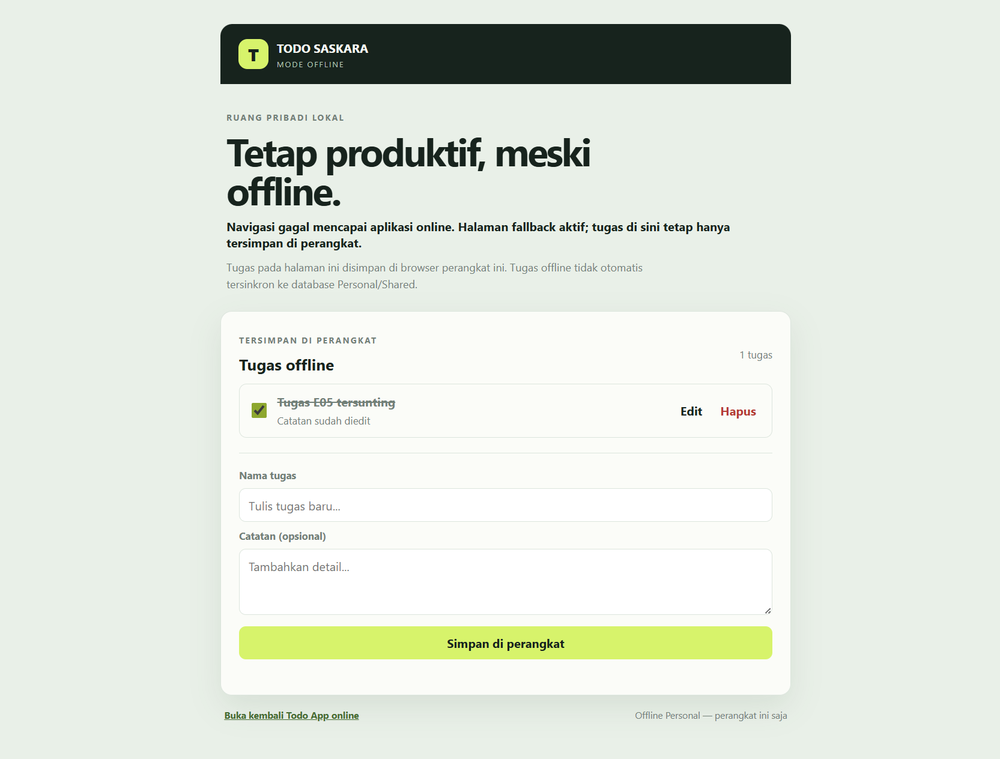

# TODO SASKARA

Aplikasi Todo List kolaboratif berbasis PHP dan MySQL. Daftar **Personal** terpisah per sesi browser, sedangkan daftar **Shared** disimpan di database yang sama dan terlihat oleh semua pengguna aplikasi.

## Fitur

- Menu Personal dan Shared dengan data tersimpan permanen di MySQL.
- CRUD tugas: tambah, lihat, ubah, tandai selesai, dan hapus.
- Nama pengguna untuk menandai pembuat tugas Shared.
- Deskripsi, waktu pengingat, dan unggah lampiran foto.
- Notifikasi pengingat tugas pada browser setelah izin notifikasi diaktifkan.
- Perlindungan CSRF, query PDO terparameterisasi, validasi unggahan berdasarkan MIME, dan nama berkas acak.
- Tema terang/gelap.
- Progressive Web App: manifest, ikon aplikasi, tombol instalasi, dan service worker.
- Halaman offline dengan CRUD tugas Personal lokal yang tetap tersedia setelah kunjungan pertama.

## Menjalankan aplikasi

1. Siapkan PHP 8.1+ dengan ekstensi `PDO_MYSQL` dan `fileinfo`, serta MySQL/MariaDB.
2. Impor [`data.sql`](./data.sql) melalui phpMyAdmin atau jalankan `mysql -u root -p < data.sql`. Skrip ini membuat database `todo_app`, tabel, dan contoh tugas Shared.
3. Sesuaikan koneksi di `config.php` melalui environment variables bila perlu:
   - `TODO_DB_HOST` (default `127.0.0.1`)
   - `TODO_DB_NAME` (default `todo_app`)
   - `TODO_DB_USER` (default `root`)
   - `TODO_DB_PASSWORD` (default kosong)
4. Jalankan folder ini melalui Apache/PHP (misalnya `http://localhost/todo-saskara/`) atau gunakan server PHP bawaan:

   ```sh
   php -S 127.0.0.1:8000
   ```

5. Buka `http://127.0.0.1:8000` dan gunakan menu **Personal** atau **Shared**.

Folder `uploads/` dibuat otomatis saat foto pertama diunggah. Pastikan PHP/web server memiliki izin tulis pada folder proyek.

## Instalasi dan penggunaan offline

- Jalankan aplikasi melalui `http://localhost`/`http://127.0.0.1` atau HTTPS; service worker dan instalasi PWA memerlukan secure context.
- Setelah membuka aplikasi saat online, tunggu service worker aktif. Gunakan tombol **Pasang aplikasi** bila browser menampilkannya, atau pilih **Install app** dari menu browser.
- Jika aplikasi tidak dapat dijangkau, service worker menampilkan halaman offline. Tugas yang dibuat di sana dapat ditambah, diedit, diselesaikan, dan dihapus, lalu disimpan di `localStorage` browser.
- Jika browser mendeteksi koneksi terputus saat halaman utama terbuka, aplikasi otomatis membuka workspace offline.
- Tugas yang dibuat pada mode offline **hanya ada di perangkat/browser tersebut** dan tidak otomatis tersinkron ke database Personal/Shared. Operasi database tetap memerlukan server PHP dan MySQL yang aktif.
- Strategi cache: shell statis (halaman offline, CSS/JavaScript, manifest, dan ikon) memakai cache-first; navigasi PHP memakai network-first dengan halaman offline sebagai fallback; POST dan halaman/database dinamis tidak di-cache.

## Laporan pengujian offline

Pengujian lokal pada 2 November 2026:

- Manifest dan ikon 192/512 berhasil dimuat; service worker berstatus aktif dan cache `todo-saskara-v8` berisi semua aset shell.
- Uji CRUD lokal offline: tambah, edit, tandai selesai, hapus, dan penyimpanan setelah halaman dimuat ulang berhasil.
- Uji fallback: navigasi aplikasi saat server lokal tidak dapat dijangkau diarahkan ke halaman offline yang telah di-cache.
- Bukti layar:




Untuk mengulang pengujian di Chrome/Edge: buka **DevTools → Application** untuk memeriksa Manifest dan Service Workers, pastikan aset ada pada **Cache Storage → todo-saskara-v8**, lalu di **Network** aktifkan **Offline** dan muat ulang aplikasi. Setelah selesai, matikan **Offline** lagi. CRUD offline di halaman ini hanya membuktikan penyimpanan lokal, bukan sinkronisasi ke database.

## Identitas

- Nama: I Made Saskara Bawa
- NRP: 5025251205
